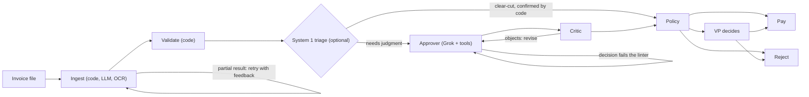

# Acme Invoice Agents

Acme Corp loses $2M a year processing invoices by hand: staff retype messy PDFs, check them against an inconsistent inventory database and chase VP approvals over email, with a 30% error rate and five-day delays. This repository replaces that workflow with agents that read and judge each invoice, and code that checks every fact and sets the limits the agents cannot cross.

**On the 20 sample invoices, live on Grok: 20 of 20 end where they should, in 24 seconds and about two cents of model calls each. Nine attacks written to get a bad invoice paid: none paid.**

## See it work

### The web console

Every sample runs; the overview, the impact against the manual process and the routing of all 20 invoices fill in; then a VP approves the invoice billed in euros, with a note for the audit log.


[Full video (27 s)](docs/demo/web-console.mp4)

### The terminal, live on Grok

A fraudulent text invoice, run live: Grok extracts it, validation flags the zero-stock item and the pressure to pay, the approver checks inventory and vendor history with tool calls, the critic agrees, and it is rejected. Waits for the model are sped up and labelled.


[Full video (47 s)](docs/demo/cli-live.mp4), which goes on to a euro invoice that a VP approves at the prompt.

## Quick start

```bash
make install                 # Python (uv) and web dependencies, pre-commit hooks
cp .env.example .env         # add XAI_API_KEY or OPENROUTER_API_KEY to run live
python main.py --invoice_path=data/invoices/invoice_1001.txt
```

Or, with only Docker: `docker compose up`, then open http://localhost:8000 (the API, the console and Redis in one command), and `docker compose run --rm cli --invoice_path=data/invoices/invoice_1001.txt` for the CLI.

**Live or replay.** With `XAI_API_KEY` (or `OPENROUTER_API_KEY`) in `.env`, every agent runs live on Grok. Without a key, the agents answer from a recording of a live run (`data/replay/recording.json`), at the pace the live run took (`REPLAY_PACE=0` for at once), while validation, the payment policy, the VP pause and payment all run for real; the CLI and the console both say when that is what you are watching.

The spec command runs the invoice, then stays in an interactive console; from a script, with `--json` or with `--once`, it runs and exits. `--dir data/invoices` runs a folder, `--watch` treats `data/inbox/` as the AP mailbox, `--vp ask|approve|reject|wait` answers invoices that pause for a VP, and `--log-json FILE` writes every step as a JSON line.

## What stands out

### A terminal you can talk to

`python main.py` opens a console that takes the web console's actions as `/commands` (`/run`, `/dir`, `/runs`, `/approve`, `/reject`, `/inventory`, `/eval`, `/watch`, `/history`, …), with a menu on `/`, Tab completion and suggestions for typos. Anything else is a request in plain words:

```
terminal  ❯ please process invoice 1004 from the samples
          ◆ grok-4.3  1,363 tokens
            Processing invoice_1004.json from data/invoices/ with the run command.
              → /run data/invoices/invoice_1004.json
            … the run …
            INV-1004 was paid.

web       Why did the invoice I just ran get paid? Then run the revised version of it.
            → /run data/invoices/invoice_1004_revised.json
            INV-1004 was rejected (ALREADY_PAID): …
```

<sub>Condensed from a live session: the first request typed in the terminal, the second in the web console.</sub>

Grok turns the request into commands, each shown before it runs. It remembers the conversation: the turns are kept in Redis through LangChain's `RedisChatMessageHistory`, trimmed to a buffer with `trim_messages`, so "it" and "the next one" make sense. The web console has the same assistant on **the same conversation**, so a request typed in the terminal is context for one typed in the browser, and the reverse.

What it may do is limited in code, not in the prompt: it can run sample invoices and look things up, but never approve, reject or change how VP pauses are answered, and a path it was not given is dropped. A sentence, or an instruction planted inside one, never moves money.

### A console a finance team can read

- **The agent stream reads as a conversation:** who acted and on which model, what they looked up (each tool call streams in as it finishes), what they decided, how long each step took and what it cost.
- **The VP card** turns orange when an invoice waits, and separates the policy reason, the agent's reasoning point by point, and the flags to weigh. Rejecting requires a reason; approving $10,000 or more asks for a second click.
- **Overview, Impact, Routing and Settled over time** show the whole inbox: where every invoice went and why, the money held back, and the time and cost against the manual process.
- Widgets drag and resize, light and dark themes pass contrast checks, and the console updates live from one server-sent event stream.

### Business sense: what it changes for Acme

The brief gives the cost and the error rate but not the invoice volume, so the cost line is per invoice rather than a savings figure.

| Pain point in the brief | What the system does instead | Measured |
|---|---|---|
| 30% error rate | Every amount, stock level, duplicate and threshold is checked in code before any agent decides | 20/20 samples correct live; 60/60 over three repeated runs, same outcome every time |
| 5-day delays | Clear-cut invoices settle without waiting for anyone | 24 s per invoice; 13 s with System 1 triage (below) |
| VP approvals over email | Only invoices that need judgment reach a VP, with the reason and the reasoning on one card; the run records which VP decided | 3 of 20 samples reach a VP; 17 settle with no person |
| $2M a year in manual handling | Model calls only where judgment is needed | $0.024 per invoice: 100,000 invoices a year is about $2,400 in model calls |
| Fraud and double payments | Deterministic checks for the known fraud patterns, a ledger that remembers paid invoices across restarts, idempotent payments | 0 of 9 attacks paid; a resent or revised paid invoice is rejected |

## Thinking, fast and slow: Jev as System 1

Kahneman's two systems map onto this pipeline. **System 2** is the reasoning approver and critic on Grok: slow, careful, about 20 seconds and two cents an invoice. **System 1** is a decision model on OpenRouter's Decisions API, [`typesafe/jev-1.14`](https://openrouter.ai/typesafe/jev-1.14): it answers two typed questions (approve, reject or escalate; does anything look off?) in a third of a second for a few thousandths of a cent.

System 1 is allowed to settle an invoice only where code agrees with it: a reject when validation already found an error, or an approve when every check passed and it sees nothing suspicious. Everything else goes to System 2. A fast answer can therefore never pay something the rules would stop.

Measured live on the 20 samples (`make eval ARGS="--triage typesafe/jev-1.14"`), in one session on the same code:

| Setup | Correct | Settled by System 1 | Mean time | Cost per invoice |
|---|---|---|---|---|
| System 2 only (Grok) | 19/20 ¹ | — | 31.6 s | $0.0257 |
| + Jev as System 1 | 20/20 | 7 of 20 | 22.9 s (−28%) | $0.0178 (−31%) |
| + Jev, three runs each | 60/60, same outcome every run | 20 of 60 | 22.8 s | $0.0192 |
| + `perplexity/pplx-decider-flash-v1.2` | 20/20 | 16 of 20 | 12.9 s (−59%) | $0.0087 (−66%) |

¹ The miss was INV-1004, which Grok rejected because the vendor's address is the Simpsons' house, though every check passed. The decision linter now sends such a rejection back as an escalation, and today's Grok-only run is 20/20 at 23.9 s and $0.0239.

**Saved:** a third of the cost with Jev, two thirds with Perplexity, with no loss in accuracy. **Speed:** a settled invoice skips ~20 s of reasoning, so the mean drops by 28% to 59%. **Effect:** the same outcome on every case; across all six decision models tried, none was ever wrong when it settled an invoice alone, because code only lets it settle what the rules already decide:

| System 1 model | Agrees with expected | Would settle alone | Wrong when settling alone | Latency | Cost per invoice |
|---|---|---|---|---|---|
| `typesafe/jev-1.14` | 100% | 7 | 0 | 0.31 s | $0.000032 |
| `perplexity/pplx-decider-flash-v1.2` | 100% | 16 | 0 | 0.27 s | $0.000008 |
| `microsoft/microsoft-decision-1` | 100% | 16 | 0 | 0.49 s | $0.000016 |
| `liquid/d1` | 100% | 10 | 0 | 0.34 s | $0.000009 |
| `cloudflare/clef` | 100% | 4 | 0 | 0.42 s | $0.000107 |
| `cloudflare/clef-flash` | 90% | 2 | 0 | 0.68 s | $0.000011 |

The decision models see the findings code computed, so agreement mostly measures whether they read those findings correctly; twenty invoices is a smoke test, not a benchmark. Triage is off by default (it needs the Decisions API) and on with `TRIAGE_MODEL=typesafe/jev-1.14`.

## Agents judge, code decides

Every number that moves money is computed in code: totals, stock, duplicates, currency and the approval threshold. The agents read documents, weigh warnings and explain themselves, and code checks what they submit. An agent can be stricter than the rules, never looser.



- **Ingest.** JSON, CSV and XML are parsed in code. TXT and PDF go to an extraction agent on `grok-4.3`, which returns a typed `Invoice` and lists each OCR fix it made; a partial result goes back with the problems listed, up to three attempts, and a value the document's text does not contain is flagged. A structured file in a layout code can't read is handed to the agent as text. Scanned PDFs and photos are read with [Docling](https://github.com/docling-project/docling) when the optional extra is installed (`uv sync --extra ocr`).
- **Validate.** Deterministic checks, no LLM: arithmetic, non-positive amounts, quantities summed per item against SQLite stock, unknown items, prices well above list, duplicates and revisions (per vendor, remembered across restarts), invoices split to stay under the threshold, vendor names a letter off the vendor master, vendors announcing a new name, currency (the threshold is in dollars), dates against terms, pressure language, instructions addressed to the reviewer, and requests to change bank details.
- **Approve.** A function-calling agent on `grok-4.7` looks up what its decision depends on (`check_inventory`, `vendor_history`, `convert_to_usd`) and submits its decision through a `SubmitDecision` tool, which a linter in code checks before accepting.
- **Critique.** A critic checks the draft against the findings, the policy and the lookups, and can send it back; a dispute still open after two rounds goes to a VP.
- **Policy.** Code has the last word. An error means reject; over $10,000 means a VP, as do the warnings in `VP_REQUIRED_FINDINGS`. The VP's answer resumes the paused run, even after a restart.
- **Pay.** `mock_payment`, behind an idempotency key, so a node that runs again after a crash can't pay twice. Every outcome is logged with its reason, in the ledger and in `logs/decisions.jsonl`.

### Five loops catch mistakes before a person sees them

| Loop | Catches | Limit |
|---|---|---|
| Extraction retry | An empty or partial extraction, sent back with what is missing | 3 attempts |
| Decision linter | Approving past an error, rejecting an invoice that passed every check, leaving a finding unaddressed, deciding without the lookup a finding depends on | 6 model turns, then a forced decision |
| No decision | A model that ignores even the forced decision | Escalates to a person |
| Critic | A draft that ignores a warning or accepts a weak explanation | 2 rounds, then a VP |
| Provider retry | Rate limits, upstream errors inside a 200 response, malformed responses | 3 attempts per call |

The linter exists because of what the eval showed: in early runs Grok paid INV-1012 ($9,975, $25 under the VP threshold) and INV-1014 (billed in EUR) on its own judgment. Those warnings now always reach a VP.

## Accuracy, speed and cost

`make eval` scores every case against its expected outcome and the findings it must rest on, and reports latency and cost from the provider's token counts (`--set samples|adversarial|held_out|scanned|all`, `--repeat N`).

| Set | Cases | Live result |
|---|---|---|
| The brief's samples | 20 | 20/20, 23.9 s and $0.024 per invoice |
| Adversarial: instructions to the reviewer, a new bank account, a split order, a price 3.2× list | 4 | 4/4, none paid |
| Held-out: a resubmission under a new number, a misspelt vendor, a claimed CFO approval, a homoglyph item, a padded surcharge | 5 | 5/5, none paid |

The held-out set was written after the adversarial fixes and committed before it was scored; it got one lookalike vendor paid, which led to the lookalike check and later the vendor master, so its result is no longer a held-out one.

**Where the time goes.** Code is milliseconds: validation, policy and payment together take under 20 ms. The time is the models: a text invoice's extraction takes about 10 s, the approver about 9 s with its tool calls, the critic about 8 s (medians from the recording). A structured invoice skips extraction. System 1 triage answers in 0.3 s and, when it settles an invoice, skips the approver and the critic.

**Which critic?** On the same 24 cases, a critic on the approver's own model never objected, while `anthropic/claude-haiku-5.5` objected on 11 and `openai/gpt-6-luna` on 7, with the same outcomes (code applies the policy whatever the critic says) and similar cost. The default stays on the approver's model; `CRITIC_MODEL` switches it.

## Design decisions

| Decision | Choice | Why | Cost |
|---|---|---|---|
| Orchestration | LangGraph | `interrupt()` with a checkpointer pauses a run for the VP across requests and restarts; the retry and review loops are edges | One more framework |
| Reasoning model | Grok: `grok-4.3` to extract, `grok-4.7` to review; xAI directly or through OpenRouter | The brief asks for Grok; one OpenRouter key also reaches the decision models | Live runs need a network |
| Validation | Plain Python over SQLite | Money decisions must be reproducible and auditable | Rules need upkeep |
| Triage | Optional System 1 with a code-confirmed fast path | 31–66% cheaper, 28–59% faster, no accuracy lost | A second API; limited to outcomes the rules allow |
| Memory | A ledger of received invoices and outcomes; idempotent payment keys | Duplicates and double payments must survive a restart | State to reset for a demo (`--reset`, Start over) |
| Assistant | Plan-then-run with code allowlists; Redis-backed shared history | Plain words in both consoles without letting text move money | Needs a live model; Redis to share |
| Replay | Record each agent's answers and timing, keyed by its inputs | Reviewers without a key see the real agents, at the real pace | A recording to refresh when inputs change; a test fails when it no longer covers every eval case |
| VP identity | A bearer token per VP; the run records whose | Separation of duties needs the approver to be someone, provably | Shared secrets, not SSO |
| OCR | Docling, optional | Local, CPU, MIT; text PDFs keep the fast path | A heavy install |

## API

| Method | Path | |
|---|---|---|
| `POST` | `/api/runs`, `/api/runs/upload`, `/api/runs/batch` | Run a sample, an uploaded file, or every sample in order |
| `GET` | `/api/runs`, `/api/runs/{id}` | Run list; one run's state and events |
| `GET` | `/api/runs/{id}/events`, `/api/events` | Server-sent events for one run or all |
| `POST` | `/api/runs/{id}/decision` | The VP's answer; a rejection needs a reason; `Authorization: Bearer <token>` when `VP_TOKENS` is set |
| `GET`, `POST` | `/api/chat` | The shared assistant conversation; ask it something |
| `POST` | `/api/reset` | Start over: forget runs, received invoices and payment keys |

`make api` serves it on http://localhost:8000 with interactive docs at `/docs`.

## Development

```bash
make check      # ruff, pyright, pytest (95% coverage floor), eslint, prettier, tsc, vitest, build
make eval       # ARGS="--set all --repeat 3 --triage typesafe/jev-1.14 --critic MODEL"
```

CI runs 350 Python tests (97% coverage, one against a real Redis), 50 web tests, and a Docker job that builds the image and runs the spec command through it. `RECORD_TO=data/replay/recording.json` on a live run refreshes the replay recording. Set `LANGSMITH_TRACING=true` to send every model and tool call to LangSmith.

**Where to start reading:** `graph.py` (the pipeline), `agents.py` (the agents), `guardrails.py` (the decision linter), `approval.py` (the policy), `validation.py` (the checks). The CLI console (`shell.py`, `terminal.py`), the assistant and triage are optional layers on top.

## What's left out

- Payment, exchange rates and the inventory are mocks; invoices arrive as files (or a watched folder) rather than email.
- Stock isn't reserved when an invoice is paid: each is checked against stock on hand, as the brief's samples expect.
- VP identity is a shared token per person; production would use SSO, roles and a second approver above a limit.
- The eval is 20 samples, 9 attacks and 2 scans, labelled by me; a few hundred real labelled invoices would come before trusting the numbers.
- OCR runs on CPU in the API process; a GPU worker would be the production choice.

## Credits

The case brief (`docs/case-brief.md`) and the sample invoices in `data/` come from [galatiq-ai/galatiq-case-invoices](https://github.com/galatiq-ai/galatiq-case-invoices). The console's backdrop is "City Streets" from [StockSnap](https://stocksnap.io/), released under CC0.
