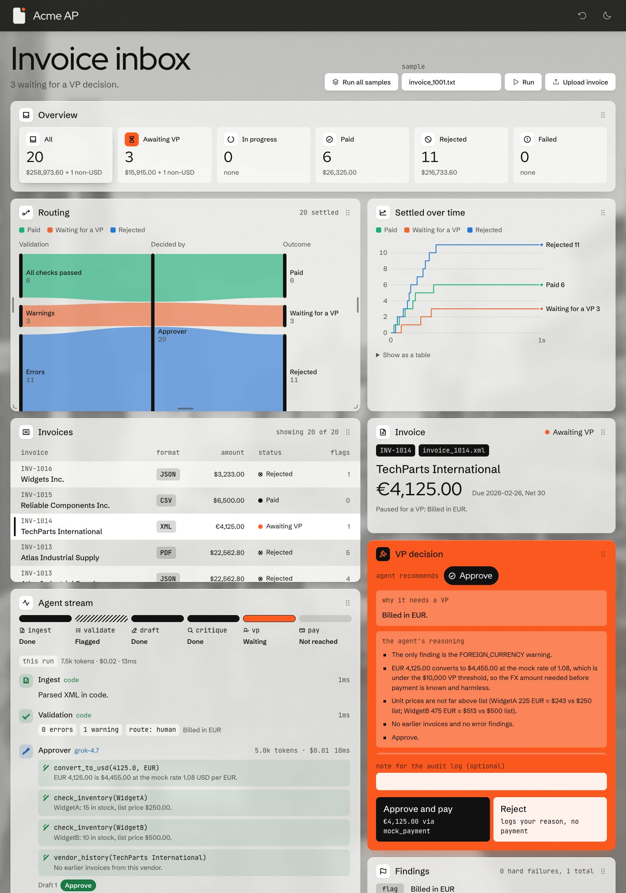
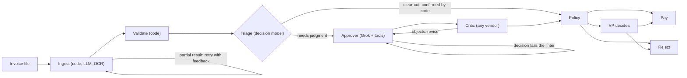
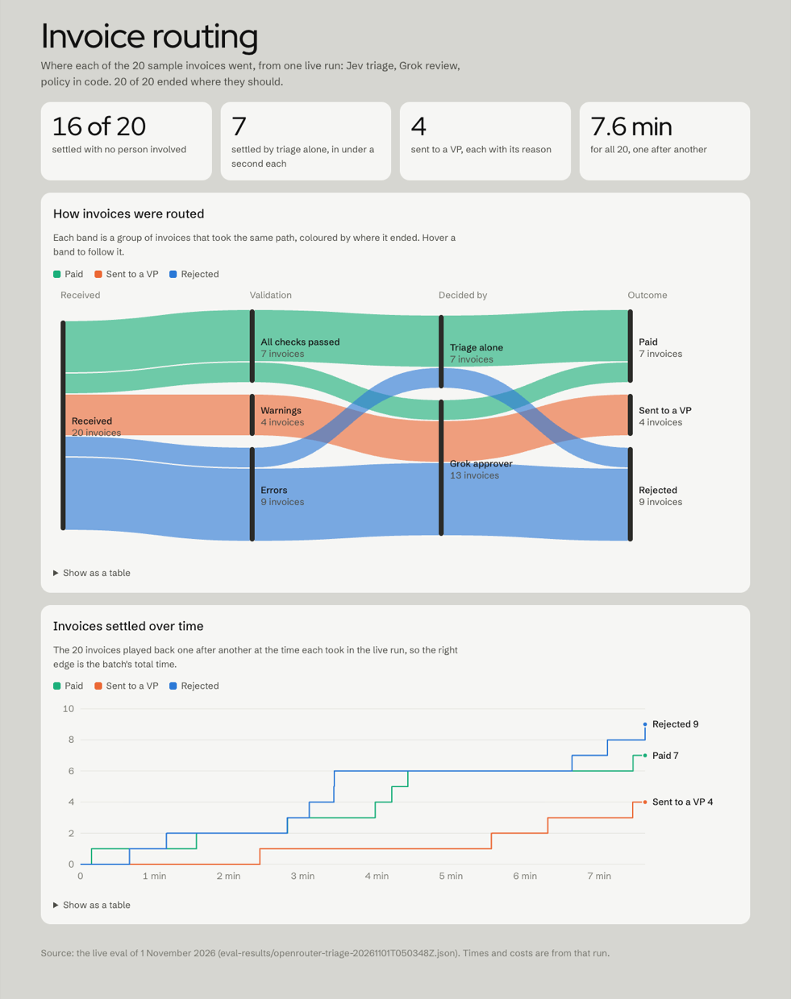

# Acme Invoice Agents

Acme Corp loses $2M a year processing invoices by hand. Staff retype messy PDFs, check them against an inconsistent inventory database and chase VP approvals over email, with a 30% error rate and five-day delays. This repository replaces that workflow with agents that read and judge each invoice, and code that checks every fact and sets the limits the agents cannot cross.

**Run three times over the 20 sample cases, all 60 runs ended where they should and every case gave the same outcome each time, in 23 seconds and about two cents of model calls per invoice. Attacks written to get a bad invoice paid were all stopped after one round of fixes; a second set the checks had never seen got one through, which is now closed too.**



## Quick start

Requires [uv](https://docs.astral.sh/uv/) and Node 20+ for the console.

```bash
make install                # Python and web dependencies, pre-commit hooks
cp .env.example .env        # replay mode: no API key needed
python main.py --invoice_path=data/invoices/invoice_1013.json
python main.py --dir data/invoices --vp ask
python main.py --serve      # the API and the console; open http://localhost:5173
```

`.env.example` starts in **replay** mode. The extraction agent, the approver and the critic answer from a recording of a live Grok run (`data/replay/recording.json`), while validation, the payment policy, the VP pause and payment all run for real. A reviewer without a key sees the same agent conversation, tool calls and per-step costs the live run produced. To run the models live, set `LLM_PROVIDER=openrouter` and `OPENROUTER_API_KEY`.

`--vp ask|approve|reject` answers invoices that pause for a VP, and `--json` prints the results to stdout. While the API is up, the CLI runs through it, so every run also shows in the console.

## What it changes for Acme

The brief gives the cost and the error rate but not the invoice volume, so the cost line below is per invoice rather than a savings figure.

| Pain point in the brief | What the system does instead | Measured |
|---|---|---|
| 30% error rate | Every amount, stock level, duplicate and threshold is checked in code before any agent decides | 60 of 60 runs on the samples ended at the expected outcome (20 cases, three runs each), with the same outcome every time |
| 5-day delays | Clear-cut invoices settle without waiting for anyone | 22.8 s per invoice on average; triage settled 20 of the 60 runs without the reasoning model |
| VP approvals over email | Only invoices that need judgment reach a VP, with the reason and the agent's reasoning on one card, and the decision records which VP made it | 4 of 20 reached a VP in a single run |
| $2M a year in manual handling | Model calls only where judgment is needed | $0.019 per invoice; even 100,000 invoices a year would cost about $1,900 in model calls |
| Fraud, which manual review is supposed to catch | Deterministic checks for the known payment-fraud patterns, and a VP for anything that matches | 0 of 12 attack runs paid; 3 of 15 held-out attack runs paid before the fix described below |

## Agents judge, code decides

Every number that moves money is computed in code: totals, stock, duplicates, currency and the approval threshold. The agents read documents, weigh warnings and explain themselves, and code checks what they submit. An agent can be stricter than the rules, never looser.



- **Ingest.** JSON, CSV and XML are parsed in code. TXT and PDF go to an extraction agent on `grok-4.3`, which returns a typed `Invoice` and lists each OCR fix it made; an empty or partial result goes back with the problems listed, up to three attempts. Scanned PDFs and photos (PNG, JPG) are read first with [Docling](https://github.com/docling-project/docling) through LangChain's `DoclingLoader`, on CPU and offline, when the optional extra is installed (`uv sync --extra ocr`).
- **Validate.** Deterministic checks, no LLM: line and total arithmetic, quantities summed per item against SQLite stock, unknown items, prices well above list, duplicates and revisions, invoices split to stay under the threshold, vendor names a letter off a known vendor, currency, dates against payment terms, pressure language, instructions addressed to the reviewer, and requests to change bank details. Each finding is an error (blocks payment), a warning (needs judgment) or a note.
- **Triage (optional).** With `TRIAGE_MODEL` set, a decision model on OpenRouter's Decisions API answers two typed questions in about 0.3 s: approve, reject or escalate, and whether anything looks off. Its answer settles the invoice only where code agrees: a reject when validation found an error, or an approve when every check passed and the model sees nothing suspicious. Everything else goes to the approver.
- **Approve.** A tool-calling agent on `grok-4.7` looks up what its decision depends on (`check_inventory`, `vendor_history`, `convert_to_usd`) and submits approve, reject or escalate through a `SubmitDecision` tool. If it never submits a valid decision, the invoice escalates to a person rather than failing.
- **Critique.** A critic checks the accepted draft against the findings, the policy and the lookups, and can send it back. `CRITIC_MODEL` runs it on another vendor's model; see the comparison below.
- **Policy.** Code has the last word. An error means reject; over $10,000 means a VP, and so do the warnings in `VP_REQUIRED_FINDINGS` (foreign currency, totals just under the threshold, revisions, splits, prices above list, instructions in the document, bank changes, lookalike vendors). The VP's answer resumes the paused run.
- **Pay.** `mock_payment` for approved invoices; rejections are logged with the reasoning.

## Where the 20 sample invoices went



This chart comes from one live run with Jev for triage and Grok for extraction and review (`make eval ARGS="--triage typesafe/jev-1.14"`). Each case runs with a fresh inventory, two at a time.

## Accuracy, speed and cost

`make eval` scores the cases against expected outcomes and reports latency and cost from the provider's token counts. `--set` picks the samples, the attacks, the held-out attacks or the scanned invoices; `--repeat N` runs each case N times and reports which ones changed outcome.

| Setup | Correct | Settled by triage | Mean time | Cost per invoice |
|---|---|---|---|---|
| Grok only | 19/20 ¹ | — | 31.6 s | $0.0257 |
| + triage, `typesafe/jev-1.14` | 20/20 | 7 | 22.9 s | $0.0178 |
| + triage, `typesafe/jev-1.14`, three runs each | 60/60, same outcome every run | 20 of 60 | 22.8 s | $0.0192 |
| + triage, `perplexity/pplx-decider-flash-v1.2` | 20/20 | 16 | 12.9 s | $0.0087 |

¹ The miss was INV-1004, which Grok rejected because the vendor address is the Simpsons' house even though every check passed. The linter now sends such a rejection back as an escalation.

Two scanned copies of INV-1011, an image-only PDF and a PNG, were read with OCR and paid (2 of 2, $0.0033 each), in about 43 s each end to end. Docling's first file loads its models; after that a page reads in about 4 s on CPU.

### Attacks

The 20 samples test messy data, not someone trying to get paid. Two attack sets do, each staying under the $10,000 VP threshold the way real payment fraud does.

| Set | Attacks | Before | After |
|---|---|---|---|
| Adversarial (`data/adversarial/`) | Instructions to the reviewer in the notes, a request to pay a new bank account, a $12,000 order split into two $6,000 invoices, a price 3.2× list | 9 of 12 runs paid | 0 of 12 paid |
| Held-out (`data/held_out/`) | A resubmission under a new number, a misspelt known vendor with a new PO box, a claimed CFO approval, a homoglyph item name, a padded surcharge | 3 of 15 runs paid, all the lookalike vendor | Lookalike: 0 of 3 paid |

The adversarial set was scored, then fixed with four deterministic checks, then rescored by the same person, so its "after" shows that the known holes are closed. The held-out set was written after those fixes and committed before it was scored, as a check on attacks nobody had tuned for. One run did happen before the commit by mistake; the commit message says so, and no case changed after it. Grok tends to reject an attack outright rather than escalate it; both count as safe, but a VP sees fewer of them.

The lookalike vendor was paid because nothing compared vendor names except for equality. A new check flags a name at least 0.88 similar to a known vendor once words like Inc and Co are ignored; the closest pair of real vendors in the samples scores 0.74. That fix was written after seeing the miss, so its 3 of 3 is no longer a held-out result.

### Which model should the critic be?

Same 24 cases (samples and adversarial), Jev triage, one run each:

| Critic | Correct | Reached the critic | Critic objected | Cost per invoice | Mean time |
|---|---|---|---|---|---|
| `grok-4.7`, the approver's own model | 24/24 | 18 | 0 | $0.020 | 35.5 s |
| `anthropic/claude-haiku-5.5` | 24/24 | 17 | 11 | $0.023 | 37.4 s |
| `openai/gpt-6-luna` | 24/24 | 16 | 7 | $0.017 | 27.2 s |

A critic on the approver's own model never pushed back. The other two objected on 40% to 65% of the invoices they saw; Haiku objected to three of the four attacks. That is the second opinion a critic is for. Outcomes did not change, because code applies the payment policy whatever the critic says; objections send the approver back for another round. The default stays the review model, and `CRITIC_MODEL=openai/gpt-6-luna` is the setting I would ship.

### Triage models

The six decision models, asked the triage questions on the same 20 cases:

| Model | Agrees with expected | Would settle alone | Wrong when settling alone | Mean latency | Cost per invoice |
|---|---|---|---|---|---|
| `typesafe/jev-1.14` | 100% | 7 | 0 | 0.31 s | $0.000032 |
| `cloudflare/clef-flash` | 90% | 2 | 0 | 0.68 s | $0.000011 |
| `cloudflare/clef` | 100% | 4 | 0 | 0.42 s | $0.000107 |
| `perplexity/pplx-decider-flash-v1.2` | 100% | 16 | 0 | 0.27 s | $0.000008 |
| `liquid/d1` | 100% | 10 | 0 | 0.34 s | $0.000009 |
| `microsoft/microsoft-decision-1` | 100% | 16 | 0 | 0.49 s | $0.000016 |

The decision models see the findings code computed, so agreement mostly measures whether they read those findings correctly; twenty invoices is a smoke test, not a benchmark. **No model was ever wrong when it settled an invoice alone, because code only lets it settle the two kinds of case the rules already decide.**

## Five loops catch mistakes before a person sees them

| Loop | Catches | Limit |
|---|---|---|
| Extraction retry | An empty or partial extraction, sent back with what is missing | 3 attempts |
| Decision linter | Approving past an error, rejecting an invoice that passed every check, leaving a finding unaddressed, or deciding without the lookup a finding depends on | 6 model turns, then a forced decision |
| No decision | A model that ignores even the forced decision | Escalates to a person |
| Critic | A draft that ignores a warning or accepts a weak explanation | 2 review rounds |
| Provider retry | Rate limits, upstream 5xx errors reported inside a 200 response, malformed responses | 3 attempts per call, after the client's own retries |

The linter exists because of what the eval showed. In early runs Grok paid INV-1012 ($9,975, $25 under the VP threshold) and INV-1014 (billed in EUR) on its own judgment; those warnings now always reach a VP, whatever the approver decides.

## What a reviewer sees

- **The console** updates live from one server-sent event stream. The inbox, the overview, the routing and settled-over-time charts, and the selected invoice's line items and findings are widgets that can be dragged and resized; light and dark themes both pass contrast checks.
- **The agent stream reads as a conversation:** who acted and on which model, what they looked up, what they decided, how long each step took and what it cost in tokens and dollars, with a total for the run.
- **The VP decision card** turns orange when an invoice waits, and separates the policy reason, the agent's reasoning point by point and the flags to weigh. Approve resumes the run.
- **The CLI** shows the same conversation in the terminal, with the pipeline as a row of lights, and asks the VP question inline. `--serve` starts the API and the console and prints the link.

## Design decisions

| Decision | Choice | Why | Cost |
|---|---|---|---|
| Orchestration | LangGraph | `interrupt()` with a checkpointer pauses a run for the VP across HTTP requests; the retry and review loops are edges in the graph | One more framework to learn |
| Reasoning model | Grok via OpenRouter: `grok-4.3` to extract, `grok-4.7` to review | The brief asks for Grok, and `grok-3` is retired; one OpenRouter key also reaches the decision models and other vendors' critics | Live runs need a network |
| Validation | Plain Python over SQLite | Money decisions must be reproducible and auditable | Rules need upkeep as policy changes |
| Triage | Optional decision model with a code-confirmed fast path | Cuts cost per invoice by 31% (Jev) to 66% (Perplexity) | Decision models can be steered by planted text, so the fast path is limited to outcomes the rules already allow |
| Critic | Any OpenRouter model, defaulting to the approver's | A same-model critic never objected in the comparison | A second vendor to depend on |
| VP rules | In code (`VP_REQUIRED_FINDINGS`) | Grok cleared two such invoices on its own in early runs | Less autonomy; set the list to `[]` to let the approver clear them |
| VP identity | A bearer token per VP (`VP_TOKENS`); the run records the name the token belongs to | Separation of duties needs the approval to be someone, provably | Shared secrets, not SSO; open when unset, for local demos |
| OCR | Docling, optional, only when a PDF has no text layer or the file is an image | Runs locally on CPU under MIT; text PDFs keep the fast path | A heavy install; the first file waits for the models to load |
| Replay | Record each agent's answers, keyed by what it was given | Reviewers see the real agents without a key; tool results still come from code | A recording to refresh when the agents' inputs change |
| Currency | Fixed mock rates | The brief rules out external APIs | Not real exchange rates |

## API

| Method | Path | |
|---|---|---|
| `POST` | `/api/runs` | Start a run on a sample: `{"sample": "invoice_1013.json"}` |
| `POST` | `/api/runs/upload` | Start a run on an uploaded file |
| `POST` | `/api/runs/batch` | Run every sample, in order |
| `GET` | `/api/runs`, `/api/runs/{id}` | Run list; one run's state and events |
| `GET` | `/api/runs/{id}/events`, `/api/events` | Server-sent events for one run or for all |
| `POST` | `/api/runs/{id}/decision` | The VP's answer: `{"approved": true, "note": "..."}`, with `Authorization: Bearer <token>` when `VP_TOKENS` is set |

`make api` serves it on http://localhost:8000 with interactive docs at `/docs`. The event stream replays history, then stays open for live events; reconnecting with `Last-Event-ID` skips what the client already has.

## Development

```bash
make check      # ruff, pyright, pytest with a 95% coverage floor, eslint, tsc, vitest, build
make eval       # the eval; ARGS="--set all --repeat 3 --triage typesafe/jev-1.14 --critic MODEL"
make format
```

CI runs 213 Python tests (98% coverage) and 37 web tests on every push; the pre-commit hook runs the linters and type checks. `RECORD_TO=data/replay/recording.json` on a live run refreshes the replay recording. LangChain's tracing works as usual: set `LANGSMITH_TRACING=true` and `LANGSMITH_API_KEY` to send every model and tool call to LangSmith.

## What's left out

- The run list lives in memory, so a restart forgets runs, including one waiting for a VP; graph checkpoints persist in SQLite and could rebuild it.
- Payment, exchange rates and the inventory are mocks, and invoices arrive as files rather than email.
- The lookalike check only knows vendors seen since the API started; production would compare against the vendor master file.
- VP identity is a shared token per person. Production would use SSO, roles, and a second approver above a limit.
- The eval is 20 sample cases, 9 attacks and 2 scans, labelled by me. A labelled set of a few hundred real invoices would be the next step before trusting the numbers above.
- OCR runs on CPU in the API process. A GPU worker, or a heavier engine such as MinerU for complex layouts, would be the production choice.

## Credits

The case brief (`docs/case-brief.md`) and the sample invoices in `data/` come from [galatiq-ai/galatiq-case-invoices](https://github.com/galatiq-ai/galatiq-case-invoices).

The console's backdrop is "City Streets" from [StockSnap](https://stocksnap.io/), released under CC0; it is shown in greyscale and blurred.
