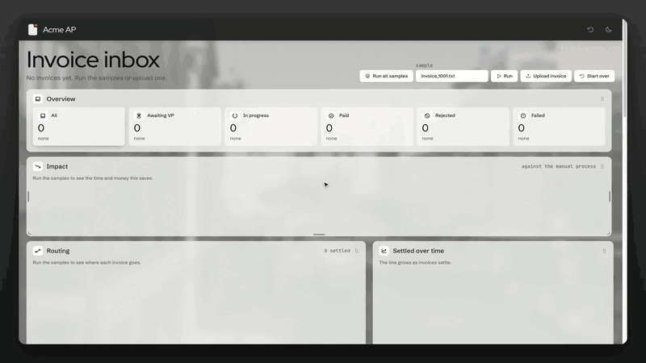
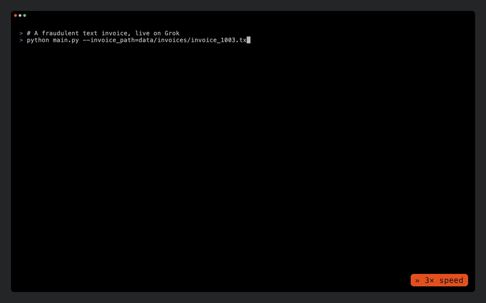
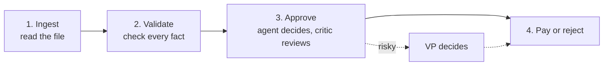
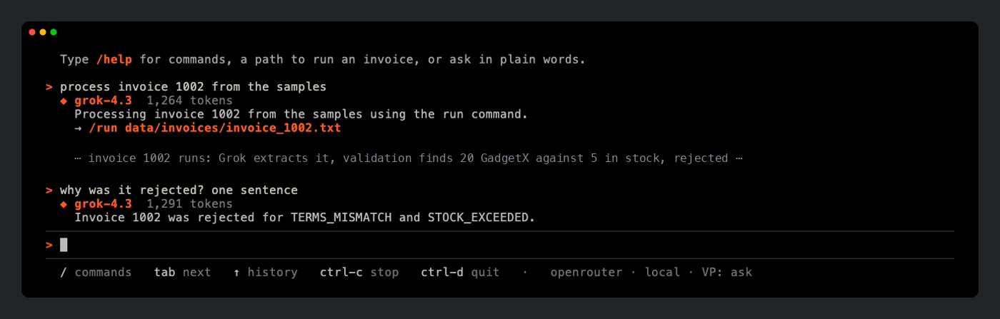
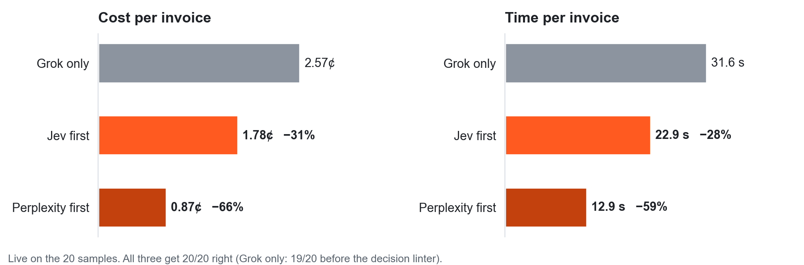

<p align="center">
  <picture>
    <source media="(prefers-color-scheme: dark)" srcset="docs/images/logo-dark.svg">
    
  </picture>
</p>

<h1 align="center">Acme Invoice Agents</h1>

<p align="center">
  <a href="https://github.com/yarikama/acme-invoice-agents/actions/workflows/ci.yml"></a>
  
  <a href="https://github.com/astral-sh/ruff"></a>
  <a href="https://microsoft.github.io/pyright/"></a>
  
  <a href="https://github.com/astral-sh/uv"></a>
  
  
</p>

AI agents that process Acme's invoices end to end: read the invoice, check it, decide, and pay or reject. Grok does the reading and the judgment; plain code checks every number and has the final say on money.

- **20 of 20** sample invoices end where they should, live on Grok.
- **About 24 seconds and 2 cents** per invoice, against 5 days by hand.
- **0 of 9** fraud attempts paid: instructions hidden in the invoice, a new bank account, an order split to dodge the VP, a misspelt vendor, a fake approval.

## See it work

### The web console

Run all samples, see where every invoice went and what it saved, then approve one as the VP.



▶ [Watch on YouTube](https://youtu.be/2TQYbxGx7Gw)

### The terminal, live on Grok

A fraudulent invoice: Grok reads it, the checks flag a zero-stock item and pressure to pay, the approver looks things up, the critic agrees, and it is rejected. Waits for the model are sped up.



▶ [Watch on YouTube](https://youtu.be/O3M04gAeVWo)

## Run it

```bash
make install                 # Python and web dependencies
cp .env.example .env         # put XAI_API_KEY (or OPENROUTER_API_KEY) here to run live
python main.py --invoice_path=data/invoices/invoice_1001.txt
```

That is the command from the brief. It prints each step as it happens and a result card at the end; `--json` prints the results as JSON.

Or with only Docker (no Python or Node needed):

```bash
cp .env.example .env         # optional: add a key to run live
docker compose up -d         # the web console and API at http://localhost:8000
docker compose run --rm cli --invoice_path=data/invoices/invoice_1001.txt
```

More ways to run it:

| Command | What it does |
|---|---|
| `python main.py --dir data/invoices` | Every sample, with a summary |
| `python main.py` | An interactive console, with the web console at http://localhost:5173 |

**No API key?** It still runs: the agents replay a recording of a real Grok run, and the screen says so.

## How it works

The brief's four stages, one step each:



1. **Ingest.** JSON, CSV and XML are read by code. Text and PDF invoices go to Grok, which fills in a typed form (vendor, amount, items, due date) and fixes typos like "2O26". If something is missing, it is asked again with what was wrong.
2. **Validate.** Code, no AI: it checks the math, stock in the SQLite inventory, unknown items, duplicates, prices, the $10,000 threshold and known fraud signs. Each problem is an error (blocks payment) or a warning (needs judgment).
3. **Approve.** A Grok agent decides approve, reject or escalate. It calls tools to look up what it needs (stock, vendor history, exchange rates). A critic reviews the decision and can send it back. Code then applies the policy: an error means reject, and big or risky invoices go to a VP.
4. **Pay or reject.** Approved invoices go to the mock payment API; rejections are logged with the reason.

The rule that holds it together: **the AI can make an invoice stricter, never looser.** It can't approve past an error or skip a VP, because code checks every decision it submits.

### The brief's test cases

| Invoice | Expected | Result |
|---|---|---|
| INV-1001, INV-1004, INV-1006 | Pass | Paid |
| INV-1002 (20 GadgetX, 5 in stock) | Stock mismatch | Rejected: `STOCK_EXCEEDED` |
| INV-1003 (FakeItem) | Out of stock or suspicious | Rejected: `OUT_OF_STOCK`, plus pressure to pay |
| INV-1008, INV-1016 | Unknown item | Rejected: `UNKNOWN_ITEM` |
| INV-1009 (negative quantity) | Data integrity issue | Rejected: `INVALID_QUANTITY`, missing vendor |

The other samples are handled too: duplicates (1011 as text and PDF), a revision of a paid invoice (1004), totals that don't add up (1007, 1013), an invoice $25 under the VP limit (1012) and one billed in euros (1014).

### The brief's requirements

| Requirement | How |
|---|---|
| Grok as the reasoning engine | `grok-4.3` reads, `grok-4.7` decides and critiques, via xAI or OpenRouter |
| Multi-agent orchestration | LangGraph: extraction, approver and critic agents in one graph, with a pause for the VP |
| Tool use, structured output, self-correction | The approver calls tools and submits a typed decision; loops retry or send work back (extraction, decision checks, critic, provider errors) |
| Everything simulated locally | SQLite inventory, mock payment, fixed exchange rates |
| Command line, structured logs and results | The command above; `--json` results; `--log-json` step logs; every outcome in `logs/decisions.jsonl` |

## What's special

**Talk to it.** Type in plain words; Grok turns the request into commands, shows each before it runs, and remembers the conversation (shared with the web console). It can never approve or pay: code doesn't let it.



**A console a finance team can use.** Each invoice reads like a conversation between the agents: what they looked up, what they decided, how long it took and what it cost. Invoices that need a VP turn orange, with the reasons on one card.

**Fast and slow thinking.** An optional fast model ([Jev](https://openrouter.ai/typesafe/jev-1.14), 0.3 s) settles the clear-cut invoices before the slow, careful Grok agents are called, but only where code agrees with it. Same accuracy, a third to two thirds cheaper:



**Built not to pay twice.** A ledger remembers every invoice across restarts, so a duplicate or a revised copy of a paid invoice is rejected, and each payment has an idempotency key, so a retried step can't pay again.

## What it means for Acme

| The brief's problem | Now |
|---|---|
| 30% error rate | Every number checked by code; 20/20 correct, same outcome on every repeated run |
| 5-day delays | About 24 seconds per invoice; 17 of 20 settle with no person |
| VP approvals over email | Only 3 of 20 reach a VP, with the reasons on one card |
| $2M a year in manual work | About $0.02 per invoice in model calls: 100,000 invoices a year is about $2,400 |
| Fraud | 0 of 9 attacks paid |

## Limits

- Payment, exchange rates and the inventory are mocks, as the brief asks; invoices come in as files or a watched folder, not email.
- The numbers come from 20 samples and 9 attacks; real labelled invoices would come next.
- VP identity is a token per person, not single sign-on.

**More:** design choices, the experiments (critic models, six fast models, attacks), the API and development notes are in [docs/DETAILS.md](docs/DETAILS.md). Start reading the code at `src/invoice_agents/graph.py`.

The brief and sample invoices come from [galatiq-ai/galatiq-case-invoices](https://github.com/galatiq-ai/galatiq-case-invoices).
