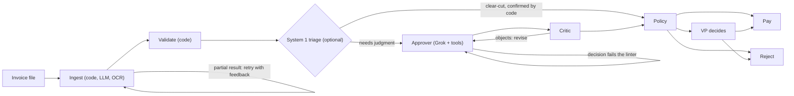

# Details

The design, the experiments and the numbers behind the [README](../README.md).

## Thinking, fast and slow: Jev as System 1

Kahneman's two systems map onto this pipeline. **System 2** is the reasoning approver and critic on Grok: slow, careful, about 20 seconds and two cents an invoice. **System 1** is a decision model on OpenRouter's Decisions API, [`typesafe/jev-1.14`](https://openrouter.ai/typesafe/jev-1.14): it answers two typed questions (approve, reject or escalate; does anything look off?) in a third of a second for a few thousandths of a cent.

System 1 is allowed to settle an invoice only where code agrees with it: a reject when validation already found an error, or an approve when every check passed and it sees nothing suspicious. Everything else goes to System 2. A fast answer can therefore never pay something the rules would stop.

Measured live on the 20 samples (`make eval ARGS="--triage typesafe/jev-1.14"`), in one session on the same code:

| Setup | Correct | Settled by System 1 | Mean time | Cost per invoice |
|---|---|---|---|---|
| System 2 only (Grok) | 19/20 ¹ | — | 31.6 s | $0.0257 |
| + Jev as System 1 | 20/20 | 7 of 20 | 22.9 s (−28%) | $0.0178 (−31%) |
| + Jev, three runs each | 60/60, same outcome every run | 20 of 60 | 22.8 s | $0.0192 |
| + `perplexity/pplx-decider-flash-v1.2` | 20/20 | 16 of 20 | 12.9 s (−59%) | $0.0087 (−66%) |

¹ The miss was INV-1004, which Grok rejected because the vendor's address is the Simpsons' house, though every check passed. The decision linter now sends such a rejection back as an escalation, and today's Grok-only run is 20/20 at 23.9 s and $0.0239.

**Saved:** a third of the cost with Jev, two thirds with Perplexity, with no loss in accuracy. **Speed:** a settled invoice skips ~20 s of reasoning, so the mean drops by 28% to 59%. **Effect:** the same outcome on every case; across all six decision models tried, none was ever wrong when it settled an invoice alone, because code only lets it settle what the rules already decide:

| System 1 model | Agrees with expected | Would settle alone | Wrong when settling alone | Latency | Cost per invoice |
|---|---|---|---|---|---|
| `typesafe/jev-1.14` | 100% | 7 | 0 | 0.31 s | $0.000032 |
| `perplexity/pplx-decider-flash-v1.2` | 100% | 16 | 0 | 0.27 s | $0.000008 |
| `microsoft/microsoft-decision-1` | 100% | 16 | 0 | 0.49 s | $0.000016 |
| `liquid/d1` | 100% | 10 | 0 | 0.34 s | $0.000009 |
| `cloudflare/clef` | 100% | 4 | 0 | 0.42 s | $0.000107 |
| `cloudflare/clef-flash` | 90% | 2 | 0 | 0.68 s | $0.000011 |

The decision models see the findings code computed, so agreement mostly measures whether they read those findings correctly; twenty invoices is a smoke test, not a benchmark. Triage is off by default (it needs the Decisions API) and on with `TRIAGE_MODEL=typesafe/jev-1.14`.

## Agents judge, code decides

Every number that moves money is computed in code: totals, stock, duplicates, currency and the approval threshold. The agents read documents, weigh warnings and explain themselves, and code checks what they submit. An agent can be stricter than the rules, never looser.



- **Ingest.** JSON, CSV and XML are parsed in code. TXT and PDF go to an extraction agent on `grok-4.3`, which returns a typed `Invoice` and lists each OCR fix it made; a partial result goes back with the problems listed, up to three attempts, and a value the document's text does not contain is flagged. A structured file in a layout code can't read is handed to the agent as text. Scanned PDFs and photos are read with OCR first; see below.
- **Validate.** Deterministic checks, no LLM: arithmetic, non-positive amounts, quantities summed per item against SQLite stock, unknown items, prices well above list, duplicates and revisions (per vendor, remembered across restarts), invoices split to stay under the threshold, vendor names a letter off the vendor master, vendors announcing a new name, currency (the threshold is in dollars), dates against terms, pressure language, instructions addressed to the reviewer, and requests to change bank details.
- **Approve.** A function-calling agent on `grok-4.7` looks up what its decision depends on (`check_inventory`, `vendor_history`, `convert_to_usd`) and submits its decision through a `SubmitDecision` tool, which a linter in code checks before accepting.
- **Critique.** A critic checks the draft against the findings, the policy and the lookups, and can send it back; a dispute still open after two rounds goes to a VP.
- **Policy.** Code has the last word. An error means reject; over $10,000 means a VP, as do the warnings in `VP_REQUIRED_FINDINGS`. The VP's answer resumes the paused run, even after a restart.
- **Pay.** `mock_payment`, behind an idempotency key, so a node that runs again after a crash can't pay twice. Every outcome is logged with its reason, in the ledger and in `logs/decisions.jsonl`.

### Scanned invoices: a parser you can switch

Scans and photos have no text layer, so they are read with OCR before the extraction agent sees them. Two parsers are installed, both reading characters with [Tesseract](https://github.com/tesseract-ocr/tesseract); `OCR_BACKEND` picks one:

| `OCR_BACKEND` | How it reads | The two sample scans, live on Grok | OCR time |
|---|---|---|---|
| `pymupdf` (default) | [PyMuPDF](https://pymupdf.readthedocs.io/) renders each page; Tesseract reads it whole, line by line, so a table row stays one line | 2/2 correct (paid), $0.022 each | about 0.5 s a page |
| `docling` | [Docling](https://github.com/docling-project/docling)'s layout model finds blocks and tables first and returns Markdown | 0/2: its table model dropped item cells on these slightly skewed scans, so both were rejected (safely, nothing paid) | about 3–6 s a page |

PyMuPDF is the default because it reads these scans correctly. Docling is the better choice for multi-column documents and real tables, where layout matters more than speed. A parser is one function from a file to text (`ingestion/ocr.py`), so another engine, such as a cloud OCR API, fits beside them. PyMuPDF is AGPL-licensed, which matters for a closed-source product; Docling is MIT.

### Five loops catch mistakes before a person sees them

| Loop | Catches | Limit |
|---|---|---|
| Extraction retry | An empty or partial extraction, sent back with what is missing | 3 attempts |
| Decision linter | Approving past an error, rejecting an invoice that passed every check, leaving a finding unaddressed, deciding without the lookup a finding depends on | 6 model turns, then a forced decision |
| No decision | A model that ignores even the forced decision | Escalates to a person |
| Critic | A draft that ignores a warning or accepts a weak explanation | 2 rounds, then a VP |
| Provider retry | Rate limits, upstream errors inside a 200 response, malformed responses | 3 attempts per call |

The linter exists because of what the eval showed: in early runs Grok paid INV-1012 ($9,975, $25 under the VP threshold) and INV-1014 (billed in EUR) on its own judgment. Those warnings now always reach a VP.

## Accuracy, speed and cost

`make eval` scores every case against its expected outcome and the findings it must rest on, and reports latency and cost from the provider's token counts (`--set samples|adversarial|held_out|scanned|all`, `--repeat N`).

| Set | Cases | Live result |
|---|---|---|
| The brief's samples | 20 | 20/20, 23.9 s and $0.024 per invoice |
| Adversarial: instructions to the reviewer, a new bank account, a split order, a price 3.2× list | 4 | 4/4, none paid |
| Held-out: a resubmission under a new number, a misspelt vendor, a claimed CFO approval, a homoglyph item, a padded surcharge | 5 | 5/5, none paid |

The held-out set was written after the adversarial fixes and committed before it was scored; it got one lookalike vendor paid, which led to the lookalike check and later the vendor master, so its result is no longer a held-out one.

**Where the time goes.** Code is milliseconds: validation, policy and payment together take under 20 ms. The time is the models: a text invoice's extraction takes about 10 s, the approver about 9 s with its tool calls, the critic about 8 s (medians from the recording). A structured invoice skips extraction. System 1 triage answers in 0.3 s and, when it settles an invoice, skips the approver and the critic.

**Which critic?** On the same 24 cases, a critic on the approver's own model never objected, while `anthropic/claude-haiku-5.5` objected on 11 and `openai/gpt-6-luna` on 7, with the same outcomes (code applies the policy whatever the critic says) and similar cost. The default stays on the approver's model; `CRITIC_MODEL` switches it.

## Design decisions

| Decision | Choice | Why | Cost |
|---|---|---|---|
| Orchestration | LangGraph | `interrupt()` with a checkpointer pauses a run for the VP across requests and restarts; the retry and review loops are edges | One more framework |
| Reasoning model | Grok: `grok-4.3` to extract, `grok-4.7` to review; xAI directly or through OpenRouter | The brief asks for Grok; one OpenRouter key also reaches the decision models | Live runs need a network |
| Validation | Plain Python over SQLite | Money decisions must be reproducible and auditable | Rules need upkeep |
| Triage | Optional System 1 with a code-confirmed fast path | 31–66% cheaper, 28–59% faster, no accuracy lost | A second API; limited to outcomes the rules allow |
| Memory | A ledger of received invoices and outcomes; idempotent payment keys | Duplicates and double payments must survive a restart | State to reset for a demo (`--reset`, Start over) |
| Assistant | Plan-then-run with code allowlists; Redis-backed shared history | Plain words in both consoles without letting text move money | Needs a live model; Redis to share |
| Replay | Record each agent's answers and timing, keyed by its inputs | Reviewers without a key see the real agents, at the real pace | A recording to refresh when inputs change; a test fails when it no longer covers every eval case |
| VP identity | A bearer token per VP; the run records whose | Separation of duties needs the approver to be someone, provably | Shared secrets, not SSO |
| OCR | PyMuPDF by default, Docling by setting; both on Tesseract | Local, CPU, no cloud; text PDFs keep the fast path | Tesseract to install; Docling brings PyTorch |

## API

| Method | Path | |
|---|---|---|
| `POST` | `/api/runs`, `/api/runs/upload`, `/api/runs/batch` | Run a sample, an uploaded file, or every sample in order |
| `GET` | `/api/runs`, `/api/runs/{id}` | Run list; one run's state and events |
| `GET` | `/api/runs/{id}/events`, `/api/events` | Server-sent events for one run or all |
| `POST` | `/api/runs/{id}/decision` | The VP's answer; a rejection needs a reason; `Authorization: Bearer <token>` when `VP_TOKENS` is set |
| `GET`, `POST` | `/api/chat` | The shared assistant conversation; ask it something |
| `POST` | `/api/reset` | Start over: forget runs, received invoices and payment keys |

`make api` serves it on http://localhost:8000 with interactive docs at `/docs`.

## Development

```bash
make check      # ruff, pyright, pytest (95% coverage floor), eslint, prettier, tsc, vitest, build
make eval       # ARGS="--set all --repeat 3 --triage typesafe/jev-1.14 --critic MODEL"
```

CI runs 350 Python tests (97% coverage, one against a real Redis), 50 web tests, and a Docker job that builds the image and runs the spec command through it. `RECORD_TO=data/replay/recording.json` on a live run refreshes the replay recording. Set `LANGSMITH_TRACING=true` to send every model and tool call to LangSmith.

**Where to start reading:** `graph.py` (the pipeline), `agents.py` (the agents), `guardrails.py` (the decision linter), `approval.py` (the policy), `validation.py` (the checks). The CLI console (`shell.py`, `terminal.py`), the assistant and triage are optional layers on top.

## Credits

The console's backdrop is "City Streets" from [StockSnap](https://stocksnap.io/), released under CC0.
